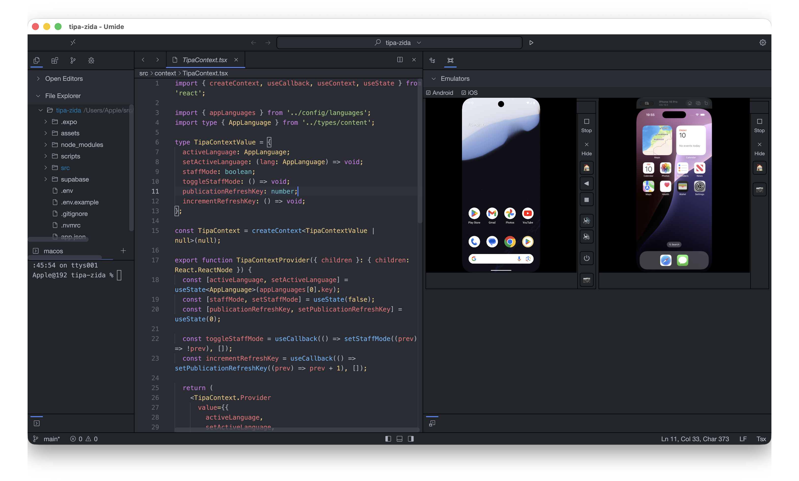
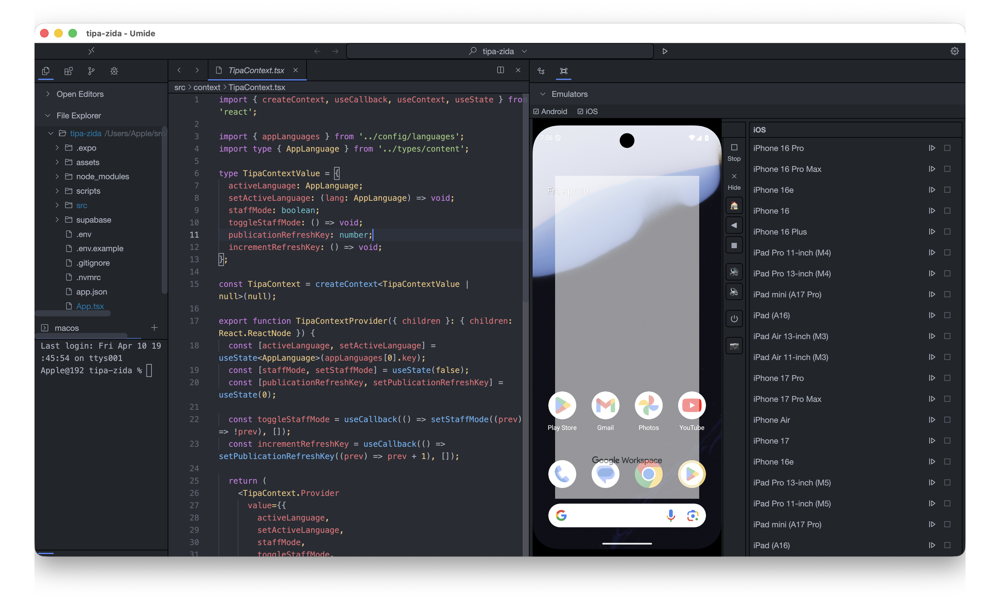
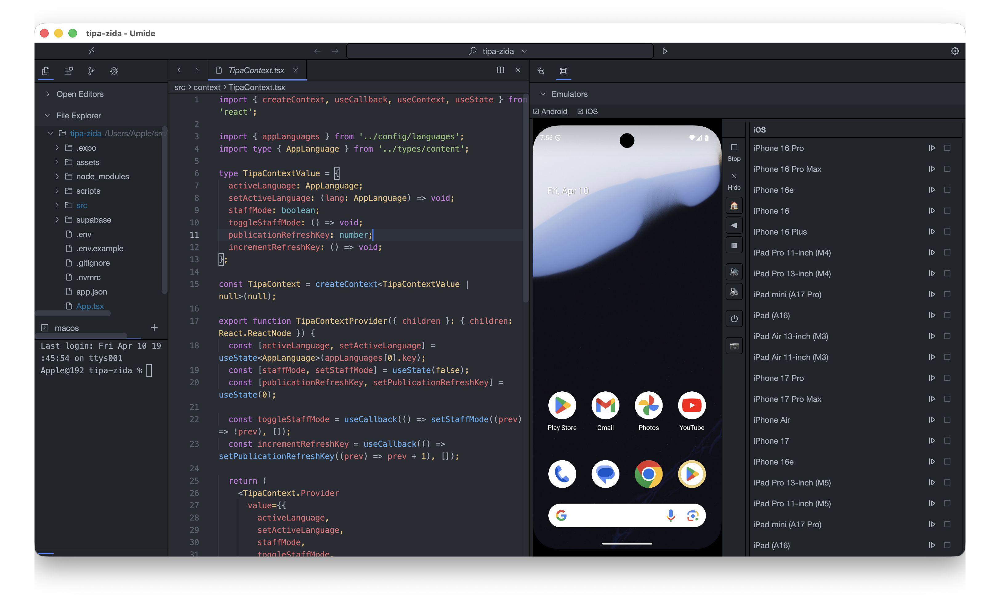
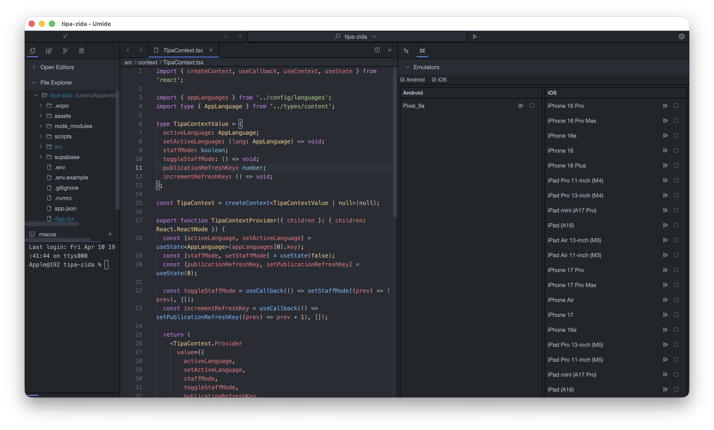

<h1 align="center">
  UMIDE
</h1>

<h4 align="center">Build and test mobile and web apps with Codex and Claude Code</h4>

  <a href="https://www.umide.dev/">Umide website</a> ·
  <a href="https://github.com/bridgerust/umide/issues/new?labels=beta&template=beta_feedback.yml">report a bug</a>
  · <a href="https://github.com/bridgerust/umide/discussions">discuss</a>.

The [native Umide Workbench](crates/umide_workbench/README.md) brings chat, project files, terminal and previews into one Rust desktop application. Codex and Claude Code can start a virtual device, run the app and check a mobile or web interaction. The first Workbench beta targets macOS and Windows x64 together. Follow the [download page](https://www.umide.dev/download) for availability, or run `cargo run --locked -p umide-workbench` from this checkout.

## Umide Classic downloads

The existing mobile IDE is available in the [Classic v0.4.0-beta.1 release](https://github.com/bridgerust/umide/releases/tag/v0.4.0-beta.1).

- **macOS** (Apple Silicon & Intel) — signed & notarized `.dmg`. Full product: editor, **embedded Android emulator + embedded iOS Simulator (no Simulator.app)**, and the AI assistant. Embedded iOS needs `brew install idb-companion` (without it, UMIDE falls back to the Simulator.app view).
- **Windows** — `.msi` installer. Editor + AI assistant + **embedded, interactive Android emulator (preview)** — live screen with tap/drag, hardware buttons (Home/Back/Recents/Power, volume, rotate), keyboard input, and a screenshot button. iOS Simulator stays macOS-only. _The installer isn't Authenticode-signed yet, so SmartScreen may warn on first run — choose **More info → Run anyway**._

New to the beta? See the [Beta testing guide](BETA.md) for setup, what to try, and known limitations.

## Classic screenshots

## Classic features

- **Unified Mobile Environment**: the Android emulator and iOS Simulator embedded directly in the IDE. On macOS the iOS Simulator runs **headless — no Simulator.app window** — booting into the panel with tap/swipe/keyboard input (requires `idb_companion`).
- **Device Logs in the IDE**: the running device's native logs — Android logcat and the iOS simulator's unified log — streamed live in a bottom panel with severity colouring, follow/tail, and Clear. No Android Studio or Xcode needed to read logs.
- **Run on Device** builds and runs your React Native, Flutter, or Expo app in a live terminal. The top bar shows **▶ Android** and **▶ iOS** on macOS and **▶ Run** on Windows. In the command palette, **Run on Device: Choose App Folder** and **Run on Device: Choose Emulator or Simulator** save the target app and device for the workspace. **Device Logs** follows that device after a run.
- **RN/Flutter auto-detection**: UMIDE detects React Native and Flutter workspaces (status-bar badge) and feeds that context to the AI assistant, so the agent knows your stack without being told.
- **AI Coding Assistant — bring your own key**: A built-in, approval-gated agent that connects to **Claude** or **OpenAI** with your API key. It reads your code, proposes edits and runs commands with **per-action approval**, and can see and drive the embedded device to verify its changes.
- **Chat sessions**: New Chat, a session switcher, and per-workspace history so conversations persist across restarts.
- **Framework support** for React Native and Flutter.
- **High Performance**: Built on [Floem](https://github.com/lapce/floem) and Rust for lightning-fast speeds.
- **Based on Lapce**: Forked from [Lapce](https://github.com/lapce/lapce), inheriting its Rust-powered speed and editor features.

## License

Copyright 2026 UMIDE contributors
Portions (original editor) Copyright 2023 Lapce contributors

UMIDE is a fork of [Lapce](https://github.com/lapce/lapce). See the [NOTICE](NOTICE) file for attribution.

Released under the Apache License Version 2.
