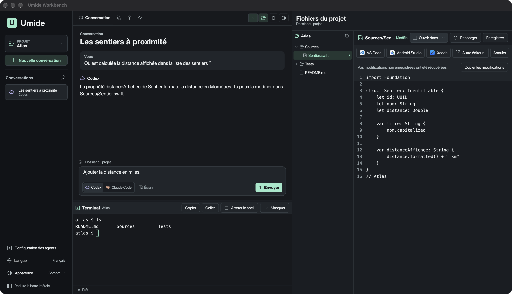

<h1 align="center">
  UMIDE
</h1>

<h4 align="center">Build and test mobile and web apps with Codex and Claude Code</h4>

  <a href="https://www.umide.dev/">Umide website</a> ·
  <a href="https://github.com/bridgerust/umide/issues/new/choose">report a bug</a>
  · <a href="https://github.com/bridgerust/umide/discussions">discuss</a>.

The [native Umide Workbench](crates/umide_workbench/README.md) brings chat, project files, terminal and previews into one Rust desktop application. Codex and Claude Code can start a virtual device, run the app and check a mobile or web interaction.

[Download Umide Workbench](https://www.umide.dev/download) for macOS (Apple Silicon and Intel), Windows x64 or Ubuntu 24.04 x86-64. To build and run Workbench from this checkout, use `cargo run --locked -p umide-workbench`.

## Mobile preview

[Watch the 17-second demo](https://www.umide.dev/#mobile-demo) to see the trail map on an iPhone simulator, then open the same trail’s elevation profile on a Pixel emulator. Select either screenshot to see the full Workbench window.

| iPhone · iOS Simulator | Pixel · Android Emulator |
| :---: | :---: |
|  |  |

See the conversation, project files and terminal

## License

Copyright 2026 UMIDE contributors

Released under the [Apache License, Version 2.0](LICENSE). See [NOTICE](NOTICE) for attribution.
