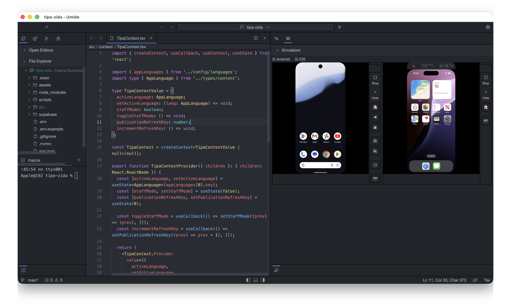
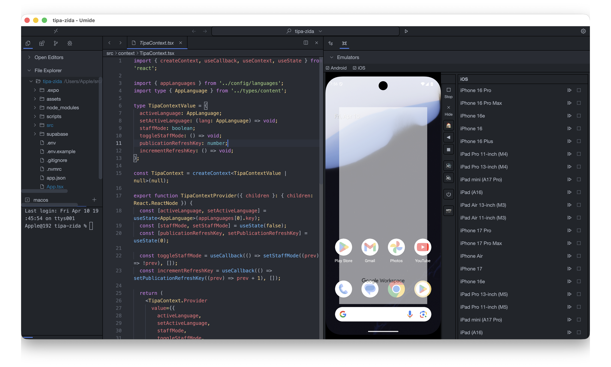
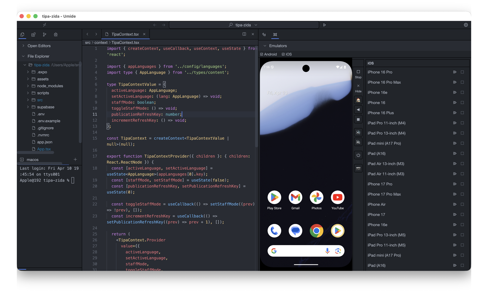
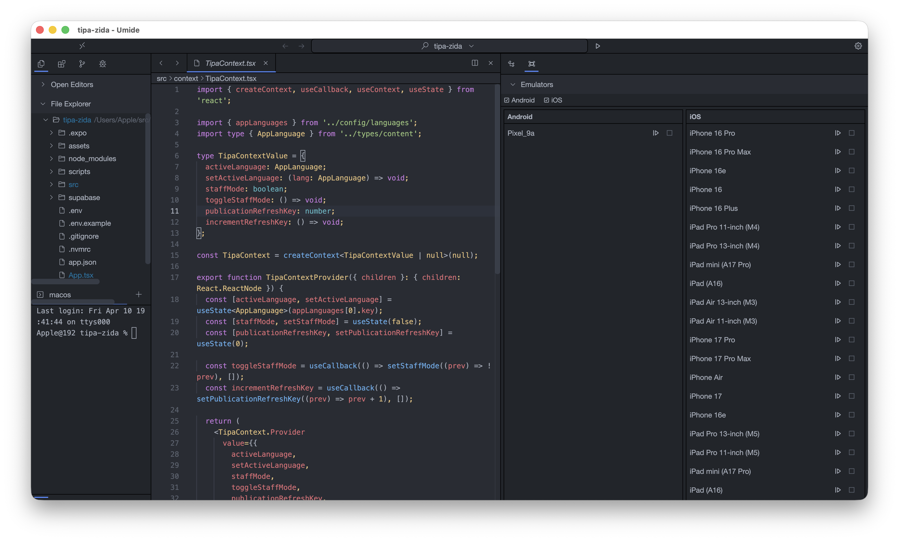

<h1 align="center">
  UMIDE
</h1>

<h4 align="center">The cross-platform mobile AI IDE — with the emulators built in</h4>

  <b>🧪 v0.4.0-beta.1 is open for beta testing.</b> 
  Try the embedded iOS Simulator (no Simulator.app) and the new top-bar Run buttons —
  <a href="https://github.com/bridgerust/umide/issues/new?labels=beta&template=beta_feedback.yml">report a bug</a>
  · <a href="https://github.com/bridgerust/umide/discussions">discuss</a>.

UMIDE is a **cross-platform mobile AI IDE** for React Native & Flutter, built in Rust. It embeds the **Android emulator and iOS Simulator right in the editor** — on macOS the iOS Simulator runs **headless, with no Simulator.app window** — and ships a built-in **AI assistant that can see and drive those devices**. One window: code, run, and debug on real devices without switching to Xcode or Android Studio.

## Download (beta)

Get the beta from the [Releases page](https://github.com/bridgerust/umide/releases) (it's marked **Pre-release**):

- **macOS** (Apple Silicon & Intel) — signed & notarized `.dmg`. Full product: editor, **embedded Android emulator + embedded iOS Simulator (no Simulator.app)**, and the AI assistant. Embedded iOS needs `brew install idb-companion` (without it, UMIDE falls back to the Simulator.app view).
- **Windows** — `.msi` installer. Editor + AI assistant + **embedded, interactive Android emulator (preview)** — live screen with tap/drag, hardware buttons (Home/Back/Recents/Power, volume, rotate), keyboard input, and a screenshot button. iOS Simulator stays macOS-only. _The installer isn't Authenticode-signed yet, so SmartScreen may warn on first run — choose **More info → Run anyway**._
- **Linux** — `.deb` or tarball. Same portable Android panel as Windows, but **preview only** (not yet run live end-to-end). iOS Simulator stays macOS-only.

New to the beta? See the [Beta testing guide](BETA.md) for setup, what to try, and known limitations.

## Screenshots

## Features

- **Unified Mobile Environment**: the Android emulator and iOS Simulator embedded directly in the IDE. On macOS the iOS Simulator runs **headless — no Simulator.app window** — booting into the panel with tap/swipe/keyboard input (requires `idb_companion`).
- **Device Logs in the IDE**: the running device's native logs — Android logcat and the iOS simulator's unified log — streamed live in a bottom panel with severity colouring, follow/tail, and Clear. No Android Studio or Xcode needed to read logs.
- **Run on Device, up top**: a prominent **▶ Run** button in the top bar. On macOS you pick the target — **▶ Android** or **▶ iOS** — and it builds & runs your React Native / Flutter / Expo app in a live terminal; other OSes show a single ▶ Run.
- **RN/Flutter auto-detection**: UMIDE detects React Native and Flutter workspaces (status-bar badge) and feeds that context to the AI assistant, so the agent knows your stack without being told.
- **AI Coding Assistant — bring your own key**: A built-in, approval-gated agent powered by the provider you already use (connect your **Claude** or **OpenAI** API key). It reads your code, proposes edits and runs commands with **per-action approval**, and can see and drive the embedded device to verify its own changes.Opt-in — the built-in BYO-key providers stay the default.
- **Chat sessions**: New Chat, a session switcher, and per-workspace history so conversations persist across restarts.
- **Cross-Platform Support**: First-class support for React Native and Flutter.
- **High Performance**: Built on [Floem](https://github.com/lapce/floem) and Rust for lightning-fast speeds.
- **Based on Lapce**: Forked from [Lapce](https://github.com/lapce/lapce), inheriting its Rust-powered speed and editor features.

## License

Copyright 2026 UMIDE contributors
Portions (original editor) Copyright 2023 Lapce contributors

UMIDE is a fork of [Lapce](https://github.com/lapce/lapce). See the [NOTICE](NOTICE) file for attribution.

Released under the Apache License Version 2.
