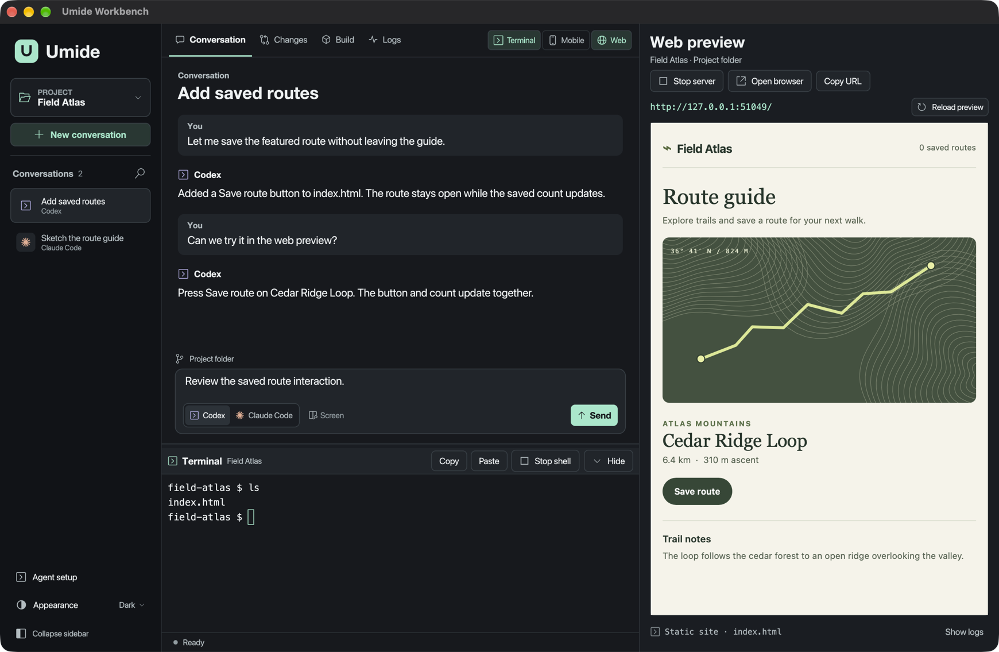
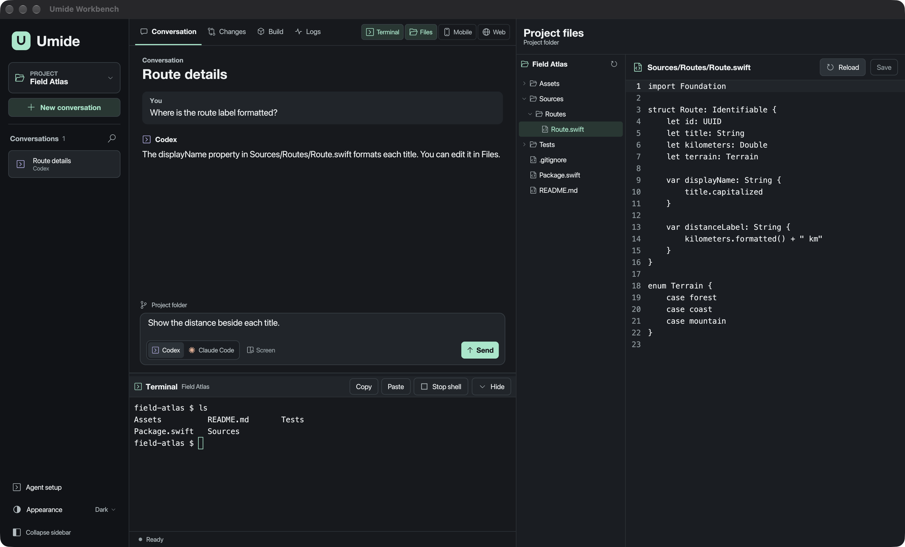

# Umide Workbench

Umide Workbench is the Rust and Floem desktop rewrite. Open a mobile or web project, choose Codex or Claude Code, and run the app alongside the conversation. The workbench stores chat history and provider session IDs locally for each project.



## First launch

When both standalone tools are missing, choose **Install both** to get them from OpenAI and Anthropic. Use **Install** on an individual provider to add just that tool. Existing installations appear with their version. **Sign in** opens the provider’s own authentication flow. Once it finishes, Umide checks the connection. Use **Continue to workspace** whenever you are ready. Reopen the assistant from **Agent setup** in the sidebar.

Umide follows the system appearance by default. Choose **Appearance → Light** or **Dark** in the sidebar to keep a fixed theme. Your choice applies to every project on this computer.

Umide starts in the first supported language in your system preferences. Use **Language** during setup or in the sidebar to switch between English, français, español and português. Umide remembers your choice across projects and restarts. Chat messages, source files and command output keep their original language. [See the French interface and editor icons](../../screenshots/umide-workbench-fr.png).

Continuing setup adds one short Umide section to the personal instructions for Codex and Claude Code. Umide respects their configured settings directories and existing instructions. The section applies when a conversation runs inside Umide. Project context, recent logs and screenshots are available to the agent on request.

## Run from source

Use stable Rust and install the Protocol Buffers compiler (`protoc`). On macOS, install the Xcode command line tools. From the repository root:

```sh
cargo run --locked -p umide-workbench
```

You can also pass an app folder after `--`. To build a local macOS development bundle, run `./crates/umide_workbench/package-macos.sh` and open `target/debug/Umide Workbench.app`.

### Beta installers

The **Workbench installers** GitHub workflow builds a universal macOS DMG, a Windows x64 MSI and an Ubuntu 24.04 x86-64 DEB. A push to `feat/native-workbench` or a manual run produces downloadable test artifacts. Each job opens the installed application and tests a form in a real browser. The macOS job also verifies both architectures, and the Windows and Linux jobs check uninstallation.

On Ubuntu 24.04 x86-64, extract the `workbench-linux` artifact and run `sudo apt install ./Umide-Workbench-Linux-x86_64.deb`. Open **Umide Workbench** from the applications menu or run `umide-workbench`. To remove it, run `sudo apt remove umide-workbench`.

A push of a Workbench beta tag matching the workspace version, such as `workbench-v0.4.0-beta.1`, starts public distribution. The release build signs and notarizes the macOS package and publishes the DMG, MSI and DEB together once all three jobs succeed. The `v*` tags belong to Umide Classic.

## Agents

- **Codex** uses the local Codex CLI and its configured authentication. Use a version that supports `codex app-server --stdio`.
- **Claude Code** uses the local Claude CLI and its own sign-in. Existing API key and cloud-provider setups can also use the CLI’s bare mode. Launch Umide from a configured environment when using shell-only credentials.
- Configure `UMIDE_CODEX_PATH` or `UMIDE_CLAUDE_PATH` with an absolute executable path if automatic detection fails.
- Select a running device and enable **Attach screen** to send its current screenshot with the next message. Command and edit requests requiring approval appear in the conversation. Use **Stop** to interrupt the active turn.
- Use **Project folder** for a conversation that edits the current checkout. For parallel work, choose **Isolated Git copy** before sending the first message. Each copy starts from the project's latest commit and excludes local uncommitted files. Commits, branches and edits made in a task checkout are accessible from **Changes → Open task folder**.
- You can move between active conversations. The sidebar indicates which agent is running or waiting for permission. Approving a tool or stopping a turn affects the selected task. Umide limits the project folder to one active agent turn at a time.
- **Changes** shows the selected task's edits. For an isolated task, it includes changes committed after the task started and lists untracked files. Its checkout stays on disk for review and later conversation turns. Open the task folder to commit or transfer the changes with Git.

### Agent verification

Describe the result you want to check. For example, “On iOS, fix Save and check that the new name appears in the list.” The agent can ask Umide for the selected device, app directory and open file, including whether the file has unsaved edits. Verification uses the conversation's checkout. A project can contain several apps, and the agent can pick the relevant subdirectory. Each conversation gets fresh context when you send or resume a turn.

- For mobile UI, the agent can select and boot an installed Android emulator or iOS simulator, launch the app, inspect its build output and device logs, take a screenshot and tap a visible control. Umide opens the device preview as the agent works. iOS requires macOS and Xcode. Tapping on iOS also requires `idb_companion`.
- For web UI, the agent can start the local dev server, open a page, interact with its controls, check visible text and capture the result. The test browser needs Node.js and an installed Chrome, Chromium, Edge or Brave. It uses a temporary profile and the local preview's origin. In **Web**, switch between **Agent browser** and **Manual preview**.
- For a logic change, the agent can run the project's own tests. Documentation work can be checked directly. The agent reports the actions it performed and any missing prerequisites. Its test server and browser close when the turn ends. An already booted virtual device stays available in Umide.

## Terminal

The workspace opens on **Conversation**. Choose **Terminal** in the toolbar to open a shell below the conversation, in the current project or isolated Git checkout. Drag the divider to resize it. Hide the terminal to give the conversation more space and reopen it to resume the same session. Umide closes the sessions when you close its window.

## Project files

Choose **Files** next to **Terminal** to browse the checkout used by the current conversation. Expand a folder and select a file to edit it alongside the chat. Use **Browse files** to switch files. A wide window can show the tree and editor side by side.

To use your editor’s code completion, type information and refactoring tools, select **Open in…** above the file. Choose **VS Code**, **Android Studio**, **Xcode** on macOS, or **Other editor…** to pick an installed application. Umide opens the file from the conversation’s checkout, including an isolated Git copy. VS Code also receives the checkout folder. Android Studio and Xcode receive the corresponding project when it can be identified. A custom editor receives the file. Language features depend on the tools and extensions installed in that editor.

If you have edits in Umide, **Save and open** writes them before opening the other editor. **Open disk version** opens the saved file and keeps your draft in Umide. When you return to the Workbench, a clean buffer picks up external changes. This action also works for files larger than the built-in editor’s limit.

Use **Save**, **⌘S** on macOS or **Ctrl+S** on Windows and Linux. Press **Esc** in the editor to return to the conversation input when it is available. Switching to another file, project or preview keeps your edits in the window. The editor opens UTF-8 text files up to 2 MiB.

If an agent or another program changes the file on disk, use **Copy edits** to keep your version before reloading. On a normal window close Umide stores unsaved drafts locally and restores them when you reopen the file. If the original file has moved or disappeared, open **Files** in the same checkout and choose **Copy edits** next to the original path.



## Web preview

Choose **Web → Start server** to run the selected conversation’s checkout. Umide uses the `dev` or `start` script from `package.json` and detects npm, pnpm, Yarn or Bun. Install the project's dependencies before starting it. Custom scripts should accept `PORT` and bind to the supplied `HOST`. For a plain HTML project, open the folder containing `index.html`. Static previews use Python 3.

On macOS the preview is interactive inside the workbench. Use **Reload preview** to refresh a static site after editing a file. **Open browser** opens the same local address in the system browser and is available on other platforms. **Show logs** displays server output and **Stop server** ends the process.

## Devices and builds

Install the Android SDK platform tools and emulator, then create an Android virtual device. For iOS, install Xcode and an available Simulator runtime on macOS. Install `idb_companion` for touch input on iOS. Xcode alone can supply the screen preview and logs.

Select a device to start it or open its preview. Click or drag on its screen to tap or swipe. Use **Run app** to build from the open folder and launch on that device. **Build** shows command output. **Stop build** terminates the running build command. **Device logs** shows recent device output and refreshes when reselected.

The runner detects Flutter, Expo and React Native app folders. The native Android path uses a Gradle wrapper and the standard `app` module producing one debug APK. The native iOS path uses an Xcode workspace or project with an identifiable app scheme. **Run app** uses the selected conversation’s folder. Install the app dependencies in that checkout before building. The workbench shares a single device preview and runs one build at a time. The Build tab identifies the originating task and device.

Run the workbench tests with `cargo test --locked -p umide-workbench -p umide_workbench_agents`. Each provider can be tested with a local model endpoint. `UMIDE_WORKBENCH_DATA_DIR` can point to an absolute temporary directory for isolated chat history.
